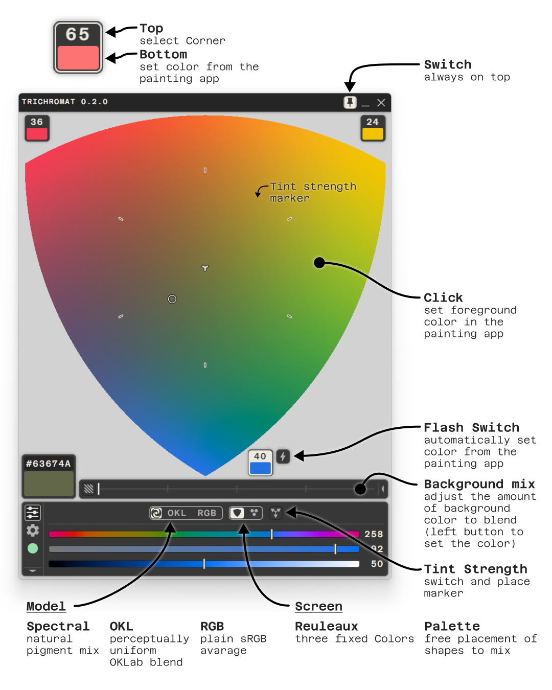

# Trichromat
Photoshop, Krita and Blender don't blend two colors the way paint does, they average the RGB values. Halfway between blue and yellow, RGB gives a dull grey. Pigments give green.

The second problem is the shape. Three colors mix over a triangle, and a triangle has an unbalanced middle: its center is twice as far from the corners as from the edges, so the two-color blends along the edges crowd the center while the corners sit far out. Trichromat mixes over a Reuleaux triangle instead. The edges bow outward as arcs. From the same three corners that gives 63 % more mixing area, and the edge blends move out to nearly the same distance from the center as the corners. The field reads evenly, and there is room to pick.

  

**Trichromat** is a color mixer for Photoshop, Krita and Blender. Three colors sit in the corners of a field, every mixture of them lies in between. Click a mixture and it is your foreground color. The app floats above your painting app, always on top. Can be switched off. Also works without a painting app: in Solo mode a pick copies the color as HEX.

### Mix models
**Spectral** (Kubelka–Munk, via spectral.js) is the default. Each color is treated as a pigment with a reflectance spectrum, and the mixture is computed from how those pigments absorb and scatter light together. Blue and yellow make green, complementary colors mute each other into browns and greys, and the tint-strength pad lets you decide which pigment dominates.

**OKL** blends linearly in OKLab, a perceptually uniform color space. Smooth, even steps, no dead grey zone in the middle and the hues stay clean.

**RGB** is the plain sRGB average, the math Photoshop and Krita use when they blend colors by default. It is the reference. Put the same three colors in and you see the muddy middle you have been working around.

## **Control everything**
The background color mixes into the field as a fourth color, in every model. One slider sets its share. A white background mixes white in, like adding white paint; a dark one pulls the mix toward dark; any other color tints it. Select the readout and the saturation and light sliders shift all three corners together, relative to where they are.

### Palette
A second screen next to the field. Place discs and rectangles of color anywhere; where they overlap, they mix, in the same three models. Each shape has its own tint and fades smoothly or in steps.

## Download and Requirement
**OS:** <ins>Windows 10/11</ins> or <ins>macOS 12</ins> or newer.

**For Photoshop:** <ins>Photoshop 26.2.0</ins> or newer versions required with the <ins>Creative Cloud</ins> desktop app. 

**For Krita:** <ins>Krita 5.2</ins> or newer. Tested on 5.3 and 6.0.

**For Blender:** <ins>Blender 5.0</ins> or newer, in Texture Paint mode.

**Download:** [Get it on Gumroad](https://745191790950.gumroad.com/l/trichromat)

## Install
### 1. The app
Extract the zip to a folder.

#### Windows
Windows SmartScreen shows "Windows protected your PC". Click `More info`, then `Run anyway`. The installer asks for the install folder and creates a Start menu and desktop shortcut.

#### MacOS
Open the `.dmg` that matches your Mac (`arm64` for Apple Silicon, `x64` for Intel) and drag Trichromat to *Applications*. 

> [!IMPORTANT]
> The app is not yet notarized, so the first launch is blocked. Open `System Settings → Privacy & Security`, scroll down to the message about Trichromat and click `Open Anyway`, then confirm. This is needed once.
> 
> 

### 2. The plugin
Start the app once before you install a plugin. The first start registers the link the plugins use to open the app.

Install the plugin for each painting app you use. Each plugin's panel shows its version number, which matches the app's.

#### Photoshop
Double-click `Trichromat-Bridge.ccx`. The Creative Cloud desktop app installs it and warns that the plugin was not verified by Adobe; **confirm**.
In Photoshop open `Plugins → Trichromat Bridge`.

If the app is not running, the panel's *Open Trichromat* button starts it.
Photoshop asks for permission the first time.

#### Krita
In Krita choose `Tools → Scripts → Import Python Plugin from File…` and pick
`Trichromat-Krita-<version>.zip` from the download. Restart Krita.

`Settings → Dockers → Trichromat Bridge` opens a small docker with the
connection status and an *Open Trichromat* button. The connection works
without the docker open.

If it's not visible, go to `Settings → Configure Krita → Python Plugin Manager`, tick **Trichromat
Bridge** and restart Krita once more.

#### Blender
In Blender drag the `.zip` file into the viewport or open `Edit → Preferences → Add-ons`, click the arrow menu at the top right, choose
`Install from Disk…` and pick `Trichromat-Blender-<version>.zip` from the download. It is
enabled right away.

Switch to Texture Paint, press `N` and open the *Trichromat* tab in the sidebar. It reads
*Connected to Trichromat* once the app is running; if it is not, the tab's *Open Trichromat*
button starts it. A pick sets the Texture Paint color.

### 3. Activate

On the first start the app asks for your license key. It is in the **Gumroad**
receipt e-mail and in your Gumroad library. Copy the key, click *Paste* in
the app, then *Activate*. Activation needs an internet connection once; afterwards the app
re-checks the key in the background from time to time.

### Updates
The app checks for a new version on start and shows **UPDATE** in the title bar.
Download the new build from your [Gumroad library](https://gumroad.com/library) and run the installer over
the old one. If the [changelog](CHANGELOG.md) says a plugin changed, install it again from the new
download, the same way as the first time. In Blender, *Install from Disk…* replaces the old version.

## Guide

  

### Color Field

Click anywhere in the field to pick a color. While Trichromat is linked to
Photoshop, Krita or Blender, the picked color becomes the foreground color; hold **Alt**
(**Option** on a Mac) while clicking to set the background color instead. You can also drag: the
color is sent when you release.

### Corners

The three corners A, B and C hold the colors you mix. Each corner has a chip
with two parts. The **number** shows how much of that corner is in the picked
color; click it to select the corner. Click the **swatch** to load the current
foreground color from your painting app into that corner.

#### Sliders
HUE, SAT and LIGHT edit whatever is selected: a corner, the background or a
shape on the palette. 

#### Flash Icon
Corner C carries a **flash** icon. Switch it on and every color you pick in your
painting app is written into C automatically. 

### Readout

The readout under the field shows the color under the selector with its HEX
value. Click the HEX value to copy it to the clipboard.

Click the readout's swatch to select it. SAT and LIGHT then shift the whole mix:
all three corners, or every shape on the palette, move together, relative to
where they are.

### Solo mode

Trichromat also works without a painting app. In **Solo mode** a click in the
field copies the HEX directly, and a corner's swatch loads the readout's color
into that corner. If you would rather keep your clipboard, switch
*COPY HEX TO CLIPBOARD IN SOLO MODE* off on the settings page; clicking the HEX
value still copies it.

### Model

- **Spectral** mixes the corners as pigments, based on Kubelka–Munk theory,
  the way physical paint behaves: blue and yellow give green.
- **OKL** blends linearly in OKLab, a perceptually uniform color space: smooth,
  even steps, clean hues. How light mixes, done right.
- **RGB** is the plain sRGB average, the same limited blend most other software
  does.

### Background mix

The row next to the readout mixes the background, the color around the field,
into the mix as a fourth color. The slider sets its share: at 0 you mix the
three corners alone, at 100 you get the background itself.

Click the icon left of the slider to edit the background color with HUE, SAT and LIGHT.

### Tint strength

Not every pigment is equally strong. Turn on the tint-strength button and drag
the marker in the field to change the relative strength of the three pigments:
toward a corner weakens that corner. The center is neutral. Alt-click the
button to reset.

### Palette

The screen switch next to the model buttons swaps the field for the
**palette**: a free surface where each color is a shape, and shapes mix where
they overlap.

- **+** adds a shape at the selector, in your foreground color. The disc / rectangle switch next to it sets
  the kind.
- **Fill** (the bucket) loads the foreground color into the selected shape.
- Select a shape's center dot to move it. A **disc** is full color at
  its center and fades to its rim; drag the rim to resize it. A **rectangle** is
  a ramp: full color at one end, fading toward the other. Drag the handle on its
  side to change the width, the one at its fading end to make it longer or
  shorter and to turn it in 30° steps.
- **TINT** sets how strongly the selected shape's color shows. Turned down, the
  shape becomes a glaze. **SMOOTH** splits the fade into 2 to 16 bands; MAX is a
  smooth fade.
- The red **×** at a selected shape's center removes it.

The models, the background mix and the readout's SAT / LIGHT shift work on the
palette too.

  

### Connection

The connection page switches between **LINKED** (talking to your painting app)
and **SOLO** (standalone). The status dot tells you where you are:

- **Green**: linked to a painting app.
- **Orange**: connecting, give it a moment.
- **Red**: no connection found. Open the Trichromat Bridge panel in your
  painting app and check it is running, **RESTART** if needed.
- **Blue**: Solo mode. Trichromat is not searching for an app; picks go to
  the clipboard and the flash and load-from-app functions are off.

#### Multiple painting apps at once

With more than one painting app connected, Trichromat talks to the one whose
plugin connected last. To switch, click *Reconnect* in the Trichromat Bridge
panel of the app you want. Switch on *SEND COLORS TO ALL CONNECTED APPS* on the
settings page and every color you send reaches all connected apps. Loading a
corner and the flash still read from the active one.

## Reporting problems or ideas

Open an issue in this repository and use the report template. Please
include for a bug the app version (settings page), your OS, your Photoshop,
Krita or Blender version, and what you did before it went wrong. Screenshots of the connection page help.
You can contact me directly: [trichromat@lukashefti.ch]()

## Privacy

The app sends your license key to Gumroad to verify it and downloads a small
version file from this repository to check for updates. Nothing else leaves
your computer. See [PRIVACY.md](PRIVACY.md).

## License

The Trichromat app and the Photoshop plugin are proprietary software licensed
under the [EULA](EULA.md). The Krita and Blender plugins are free software under
the GNU General Public License, version 3 or later; the license text ships in
each plugin as `LICENSE.txt`. Adobe
and Photoshop are trademarks of Adobe Inc.; Krita is a trademark of the Krita
Foundation (Stichting Krita); Blender is a trademark of the Blender Foundation.
Trichromat is an independent product and is not affiliated with Adobe, the
Krita Foundation or the Blender Foundation.
